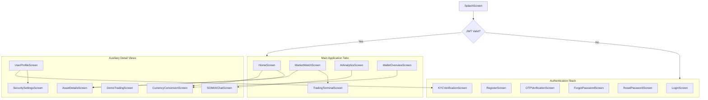

# Frontend Inventory & Structural Baseline

**Project Name:** SmartLanka Trade Frontend  
**Framework:** React Native (Expo SDK 55), TypeScript  
**Root Directory:** `Frontend/`  

---

## 1. Directory Structure & Screen Inventory

```text
Frontend/
├── assets/                          # Static image & vector assets
├── src/
│   ├── components/
│   │   ├── Card.tsx                 # Base glassmorphism card component
│   │   ├── CustomTabBar.tsx         # Bottom tab bar navigation UI
│   │   ├── DepositModal.tsx         # Virtual cash deposit modal
│   │   ├── Header.tsx               # Reusable view header
│   │   ├── NetworkErrorScreen.tsx   # Offline & retry screen
│   │   ├── PrimaryButton.tsx        # High-contrast action button
│   │   ├── SetAlertModal.tsx        # Price threshold alert modal
│   │   ├── Toast.tsx                # Status & notification toast
│   │   └── index.ts                 # Components barrel export
│   ├── navigation/
│   │   ├── AppNavigator.tsx         # Stack & Tab navigation coordination
│   │   └── types.ts                 # React Navigation route typing
│   ├── screens/
│   │   ├── ai/
│   │   │   └── SOMIAIChatScreen.tsx         # SOMI AI Copilot conversational UI
│   │   ├── analytics/
│   │   │   └── AIAnalyticsScreen.tsx        # ARIMA/LSTM forecasts & sentiment
│   │   ├── assets/
│   │   │   └── AssetDetailsScreen.tsx       # CSE stock detail & charting view
│   │   ├── auth/
│   │   │   ├── ForgotPasswordScreen.tsx     # Password reset request
│   │   │   ├── KYCVerificationScreen.tsx    # Sri Lankan NIC verification & OCR
│   │   │   ├── LoginScreen.tsx              # Email/password & Google login
│   │   │   ├── OTPVerificationScreen.tsx    # 6-digit OTP verification view
│   │   │   ├── RegisterScreen.tsx           # Account registration view
│   │   │   └── ResetPasswordScreen.tsx      # Secure password confirmation
│   │   ├── home/
│   │   │   └── HomeScreen.tsx               # Portfolio overview & CSE watchlist
│   │   ├── market/
│   │   │   ├── DemoTradingScreen.tsx        # CSE paper trading simulation
│   │   │   ├── MarketWatchScreen.tsx        # CSE sector catalog & indices
│   │   │   └── TradingTerminalScreen.tsx    # Pro trading terminal & order book
│   │   ├── profile/
│   │   │   ├── SecuritySettingsScreen.tsx   # 2FA & credential settings
│   │   │   └── UserProfileScreen.tsx        # User profile, KYC status & prefs
│   │   ├── splash/
│   │   │   └── SplashScreen.tsx             # Animated startup splash
│   │   ├── wallet/
│   │   │   ├── CurrencyConversionScreen.tsx # Zero-fee LKR/USD forex converter
│   │   │   └── WalletOverviewScreen.tsx     # Allocations, deposit & withdrawal
│   │   └── index.ts                         # Screens barrel export
│   ├── services/
│   │   └── apiService.ts                    # Central Axios client with interceptors
│   └── theme/
│       ├── colors.ts                        # High-contrast financial palette
│       ├── layout.ts                        # Spacing & layout constants
│       ├── typography.ts                    # Typography tokens
│       └── index.ts                         # Theme barrel export
├── App.tsx                                  # React Native app root
├── app.json                                 # Expo configuration
├── package.json                             # Frontend dependencies & scripts
└── tsconfig.json                            # TypeScript configuration
```

---

## 2. Navigation Flow & Screen Map


