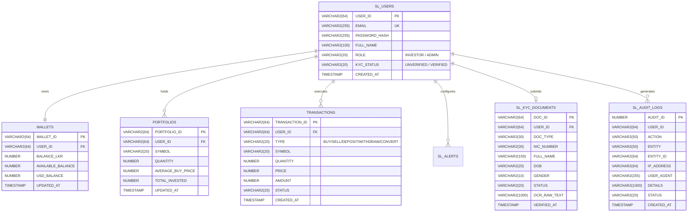

# Target Database Architecture Specification

---

## 1. Oracle DDL Entity-Relationship Design

---

## 2. Table Indexing & Performance Strategy

1. **Unique Indices:** `SL_USERS(EMAIL)`, `WALLETS(USER_ID)`, `SL_KYC_DOCUMENTS(USER_ID)`.
2. **Composite Lookup Indices:** `PORTFOLIOS(USER_ID, SYMBOL)`, `TRANSACTIONS(USER_ID, CREATED_AT)`.
3. **Partitioning / Audit Index:** `SL_AUDIT_LOGS(CREATED_AT DESC)`.
4. **Market Fast Cache:** `MARKET_CACHE(SYMBOL)` with memory-mapped in-process cache buffer for high-frequency price lookups.
