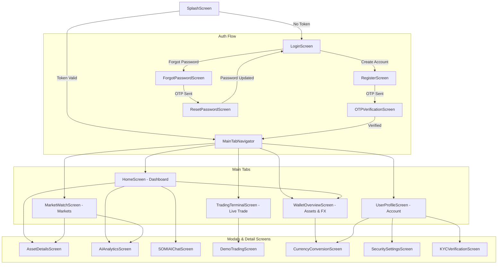

# DOCUMENT 03 — COMPLETE APP FLOW & NAVIGATION MAP
## SmartLanka Trade – User Journeys, Route Hierarchy & State Transitions

---

### 1. Navigation Architecture Overview

The application utilizes a two-tier nested navigation structure configured in `RootNavigator.tsx`:
- **Auth Stack Navigator** (`AuthStackNavigator.tsx`): Logged-out and onboarding experience.
- **Main Tab Navigator** (`MainTabNavigator.tsx`): Authenticated bottom tab dashboard.
- **Root Stack Modals**: Standalone top-level routes (`AssetDetails`, `AIAnalytics`, `SOMIAIChat`, `DemoTrading`, `CurrencyConversion`, `SecuritySettings`, `KYCVerification`).

---

### 2. Complete Navigation Route Map

---

### 3. Screen-by-Screen Journey & States

| Screen | Route Name | Required Data / APIs | Primary Actions | Key UX States |
| :--- | :--- | :--- | :--- | :--- |
| **Splash** | `Splash` | `storageService.getToken()` | Auto-login or navigate to Login | Progress bar animation |
| **Login** | `Login` | `/api/auth/login`, Google OAuth | Sign in, biometric prompt, navigation | Loading spinner, error toast, network error screen |
| **Register** | `Register` | `/api/auth/register` | Create user, password complexity check | Complexity bar, validation feedback |
| **OTP Verification** | `OTPVerification` | `/api/auth/verify-otp`, `/api/auth/resend-otp` | 6-digit pin entry, resend countdown | Auto-advance boxes, error toast |
| **Forgot Password** | `ForgotPassword` | `/api/auth/forgot-password` | Send email reset link | Success confirmation screen |
| **Reset Password** | `ResetPassword` | `/api/auth/verify-reset-otp`, `/api/auth/reset-password` | Step 1 OTP keypad, Step 2 new password | Keypad entry, strength checklist |
| **Home Dashboard** | `Home` | `/api/market/prices`, `/api/portfolio` | Watchlist, quick actions, balance card | Skeleton loading, pull-to-refresh |
| **Market Watch** | `Markets` | `/api/market/all-prices` | Search, filter categories (Crypto/Stocks) | Search-off empty state, pull-to-refresh |
| **Trading Terminal** | `Trade` | `/api/market/price`, `/api/ai/recommendation`, `/api/trade` | Select coin, BUY/SELL, limit price, mode toggle | Loading spinner, confirmation modal |
| **Asset Details** | `AssetDetails` | `/api/market/klines`, `/api/ai/recommendation` | Candlestick timeframe, live order info | Dynamic chart loading, error retry |
| **AI Analytics** | `AIAnalytics` | `/api/ai/recommendations` | Timeframe filters (1h, 4h, 1d), signal expand | Live pulse indicator, pull-to-refresh |
| **SOMI AI Chat** | `SOMIAIChat` | `/api/ai/chat` | Send queries, prompt suggestions | Typing indicator, speech bubbles |
| **Demo Trading** | `DemoTrading` | `/api/wallet`, `/api/market`, `/api/trade/demo` | Virtual trade order, paper portfolio | Toast feedback, network error screen |
| **Wallet Overview** | `Wallet` | `/api/wallet`, `/api/wallet/transactions` | Deposit, Withdraw, Transfer, Convert | Card modal sheets, pull-to-refresh |
| **Currency Conversion** | `CurrencyConversion` | `/api/market/price` (CBSL USD/LKR rate) | Real-time FX conversion calculator | Conversion success alert |
| **User Profile** | `Profile` | `/api/auth/profile`, `/api/kyc/status` | View/edit profile, privacy toggles, logout | Camera picker, KYC badge status |
| **Security Settings** | `SecuritySettings` | `/api/auth/change-password`, LocalAuth | Biometric toggle, 2FA toggle, PIN modal | Real biometric authentication |
| **KYC Verification** | `KYCVerification` | `/api/kyc/upload`, `/api/kyc/status` | Camera capture NIC, OCR parsing | OCR result card, status badge |
